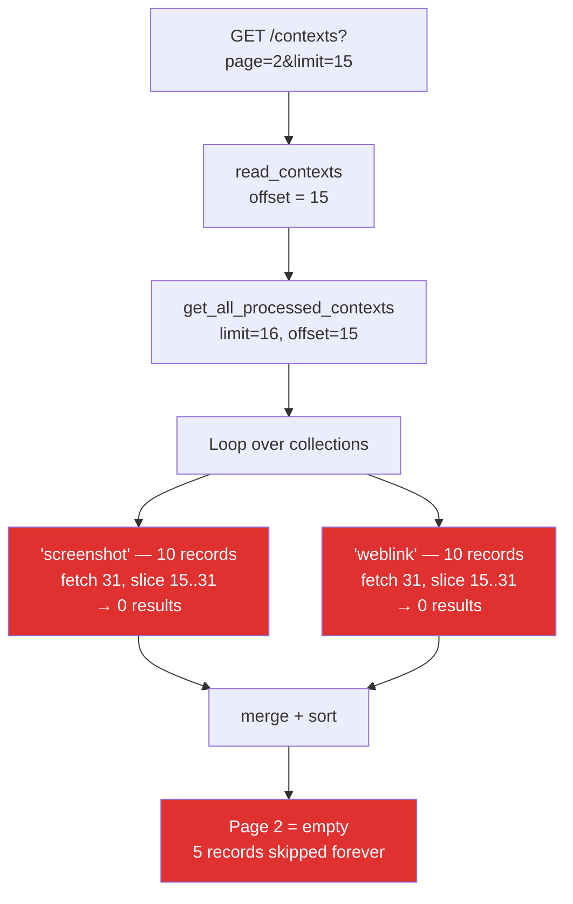
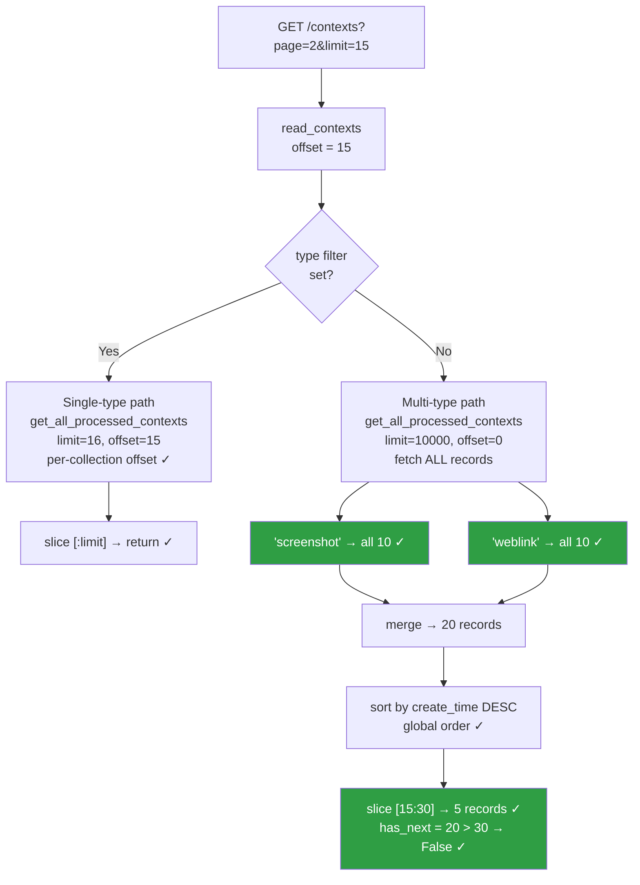

# Cross-Type Pagination Fix — Issue #377

## PR Description

**Title:** `fix(web): paginate /contexts after merging all context types`

**Branch:** `varun-projects:fix/contexts-pagination-v3` → `volcengine/MineContext:main`

---

### What's happening

`/contexts` passes the global page offset into each ChromaDB collection query
*before* merging results. With two 10-item collections and `offset=15` (page 2,
limit=15), both collections return nothing — the page is empty while five records
remain.

The root cause is in `read_contexts` (`opencontext/server/routes/web.py`): when
no type filter is set, `get_all_processed_contexts` is called with the raw
`offset`, which the ChromaDB backend applies independently to every collection it
iterates over.

### Fix

When no type filter is active, the route now fetches all records (up to 10 000),
merges and sorts them, then slices with the page offset in Python. Single-type
browsing is unchanged — it still passes offset directly to the backend, which
works correctly for a single collection.

### Scope

One-file change confined to `opencontext/server/routes/web.py`. No storage API
changes needed.

### How to verify

1. Create 10 processed contexts of type A and 10 of type B.
2. `GET /contexts?limit=15` — 15 items, `has_next=true`.
3. `GET /contexts?page=2&limit=15` — 5 items, `has_next=false`. (Was empty before.)
4. `GET /contexts?type=A&page=2&limit=8` — single-type path, behaviour unchanged.

Fixes #377

---

## Technical Documentation

### Architecture overview

MineContext stores processed contexts (screenshots, web links, documents, etc.)
across multiple ChromaDB collections — one collection per context type. The
`/contexts` web page lets users browse all types together or filter by a single
type, with standard page/limit pagination.

```
ChromaDB
├── collection: "screenshot"   (N records)
├── collection: "weblink"      (M records)
├── collection: "document"     (P records)
└── ...

GET /contexts?page=2&limit=15
     ↓
read_contexts()  ←  opencontext/server/routes/web.py
     ↓
get_all_processed_contexts()  ←  opencontext/storage/unified_storage.py
     ↓
chromadb_backend.get_all_processed_contexts()  ←  opencontext/storage/backends/chromadb_backend.py
     ↓
Loop over each collection independently
```

---

### The Bug

#### What goes wrong

```
User has:
  Collection "screenshot" — 10 records
  Collection "weblink"    — 10 records

GET /contexts?page=2&limit=15
  offset = (2-1) * 15 = 15

Backend loop:
  "screenshot": fetch top (15+15)=30, then slice [15:30]
                → only 10 records exist → slice returns 0  ✗
  "weblink":    fetch top (15+15)=30, then slice [15:30]
                → only 10 records exist → slice returns 0  ✗

Merge: []   Sort: []   Page 2: EMPTY  ✗
5 records permanently unreachable
```

#### Bug flowchart



#### Root cause in code

```python
# opencontext/server/routes/web.py  (BEFORE)
offset = (page - 1) * limit

# same offset sent to EVERY collection:
contexts_dict = get_storage().get_all_processed_contexts(
    context_types=list(types), limit=limit + 1, offset=offset   # ← BUG
)
# chromadb_backend applies offset independently per collection
```

```python
# opencontext/storage/backends/chromadb_backend.py
for context_type in context_types:                 # iterates each collection
    results = collection.get(limit=limit + offset) # fetch limit+offset items
    start_idx = min(offset, len(results["ids"]))   # apply offset to THIS collection
    end_idx   = min(start_idx + limit, ...)        # ← offset consumes the whole collection
```

---

### The Fix

#### What changes

When **no type filter** is set (multi-type browsing), fetch all records with
`offset=0`, merge them globally, sort chronologically, then apply the page slice
in Python. Single-type browsing keeps the existing per-collection offset because
querying one collection at a time is correct.

#### Fix flowchart



#### Pagination result comparison

| Scenario | Before fix | After fix |
|---|---|---|
| Page 1, 2 types × 10 records, limit=15 | 15 results ✓ | 15 results ✓ |
| Page 2, 2 types × 10 records, limit=15 | **0 results ✗** | **5 results ✓** |
| Page 1, single type, limit=15 | 15 results ✓ | 15 results ✓ |
| Page 2, single type 20 records, limit=15 | 5 results ✓ | 5 results ✓ |

---

### Code change

**File:** `opencontext/server/routes/web.py`

```python
# BEFORE ─────────────────────────────────────────────────────────────────────
offset = (page - 1) * limit
types = []
if type:
    types.append(type)
contexts_dict = get_storage().get_all_processed_contexts(
    context_types=list(types), limit=limit + 1, offset=offset, need_vector=False
)
contexts = []
for backend_contexts in contexts_dict.values():
    contexts.extend(backend_contexts)

def get_sort_key(context):
    dt = context.properties.create_time
    if dt.tzinfo is None:
        import datetime as dt_module
        dt = dt.replace(tzinfo=dt_module.timezone.utc)
    return dt

contexts.sort(key=get_sort_key, reverse=True)
has_next = len(contexts) > limit
contexts_to_display = contexts[:limit]


# AFTER ──────────────────────────────────────────────────────────────────────
offset = (page - 1) * limit

def get_sort_key(context):
    dt = context.properties.create_time
    if dt.tzinfo is None:
        import datetime as dt_module
        dt = dt.replace(tzinfo=dt_module.timezone.utc)
    return dt

if type:
    # Single-type: per-collection pagination is correct as-is
    contexts_dict = get_storage().get_all_processed_contexts(
        context_types=[type], limit=limit + 1, offset=offset, need_vector=False
    )
    contexts = []
    for backend_contexts in contexts_dict.values():
        contexts.extend(backend_contexts)
    contexts.sort(key=get_sort_key, reverse=True)
    has_next = len(contexts) > limit
    contexts_to_display = contexts[:limit]
else:
    # Multi-type: fetch everything, merge/sort, then slice in Python
    contexts_dict = get_storage().get_all_processed_contexts(
        context_types=[], limit=10_000, offset=0, need_vector=False
    )
    contexts = []
    for backend_contexts in contexts_dict.values():
        contexts.extend(backend_contexts)
    contexts.sort(key=get_sort_key, reverse=True)
    has_next = len(contexts) > offset + limit
    contexts_to_display = contexts[offset : offset + limit]
```

---

### Design decisions

| Decision | Rationale |
|---|---|
| Fix in `web.py` only | No storage API changes; all callers unaffected |
| `limit=10_000` cap | Prevents unbounded memory; realistic upper bound for a local desktop app |
| `context_types=[]` | `unified_storage` treats empty list as "all types" (line 230) — no new parameter needed |
| Sort after merge | Guarantees global chronological order across types on every page |
| Single-type path unchanged | One collection → per-collection offset is correct; no regression |

---

### Files changed

| File | Lines changed | What |
|---|---|---|
| `opencontext/server/routes/web.py` | ~25 | Split into single-type and multi-type pagination paths |
