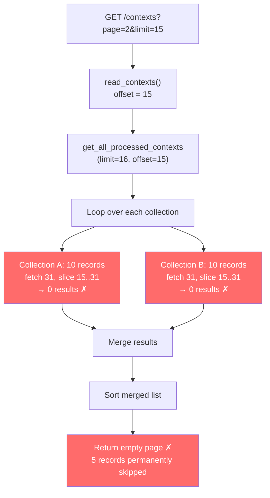
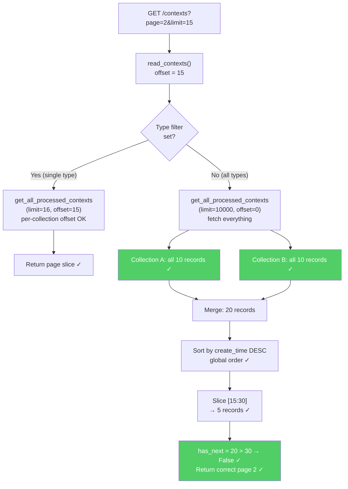

# fix(web): paginate /contexts after merging all context types

## PR Description

**Title:** `fix(web): paginate /contexts after merging all context types`

**Target:** `volcengine/MineContext` ← `varun-projects:fix/contexts-pagination-v2`

---

### What's happening

`/contexts` passes the global page offset into each ChromaDB collection
query *before* merging results. With two 10-item collections and `offset=15`
(page 2, limit=15), both collections return nothing — the page is empty
while five records remain.

The root cause is in `read_contexts` (`opencontext/server/routes/web.py`):
when no type filter is set, `get_all_processed_contexts` is called with the
raw `offset`, which the ChromaDB backend applies independently to every
collection it iterates over.

### Fix

When no type filter is active, the route now fetches all records (up to
10 000), merges and sorts them, then slices with the page offset in Python.
Single-type browsing is unchanged — it still passes offset directly to the
backend, which works correctly for a single collection.

### Scope

One-file change confined to `opencontext/server/routes/web.py`. No storage
API changes needed.

### How to verify

1. Create 10 processed contexts of type A and 10 of type B.
2. `GET /contexts?limit=15` — 15 items, `has_next=true`.
3. `GET /contexts?page=2&limit=15` — 5 items, `has_next=false`. (Was empty before.)
4. `GET /contexts?type=A&page=2&limit=8` — single-type path, unchanged.

Fixes #377

---

## Technical Documentation

### Background

MineContext stores processed contexts (screenshots, web links, documents, etc.)
across multiple ChromaDB collections — one collection per context type. The
`/contexts` web page lets users browse all types together or filter by a single
type, with standard page/limit pagination.

---

### The Bug — How Pagination Was Broken

#### Code path (before fix)

```
GET /contexts?page=2&limit=15
        │
        ▼
web.py :: read_contexts()
  offset = (page-1) * limit  →  offset = 15
        │
        ▼
unified_storage.get_all_processed_contexts(limit=16, offset=15)
        │
        ▼
chromadb_backend.get_all_processed_contexts(limit=16, offset=15)
        │
        ├─── Collection "screenshot"  (10 records total)
        │       fetch(limit+offset=31), then slice [15:31]
        │       → 0 results  ✗
        │
        └─── Collection "weblink"  (10 records total)
                fetch(limit+offset=31), then slice [15:31]
                → 0 results  ✗
        │
        ▼
merge([]) + sort([]) = []
        │
        ▼
Page 2 returns EMPTY  ✗  (5 records skipped forever)
```

#### Flowchart



#### Why this happens

ChromaDB does not support cross-collection queries. The backend iterates
each collection separately and applies `offset` to each one as if each
collection were the full dataset. When offset exceeds a collection's size,
that collection contributes zero results to the merge.

| Scenario | Collection A | Collection B | Merged | Expected |
|---|---|---|---|---|
| Page 1 (offset=0, limit=15) | 10 results | 5 results | 15 ✓ | 15 |
| Page 2 (offset=15, limit=15) | 0 results | 0 results | **0 ✗** | 5 |

---

### The Fix — Paginate After Merging

#### Code path (after fix)

```
GET /contexts?page=2&limit=15
        │
        ▼
web.py :: read_contexts()
  offset = (page-1) * limit  →  offset = 15
  type filter? NO → multi-type path
        │
        ▼
get_all_processed_contexts(limit=10_000, offset=0)
        │
        ├─── Collection "screenshot"  → all 10 records
        └─── Collection "weblink"     → all 10 records
        │
        ▼
merge all 20 records
        │
        ▼
sort by create_time DESC  (global chronological order)
        │
        ▼
slice [offset : offset+limit]  =  [15:30]  →  5 records  ✓
        │
        ▼
has_next = 20 > 15+15 → False  ✓
Page 2 returns 5 records correctly  ✓
```

#### Flowchart



---

### Code Change

**File:** `opencontext/server/routes/web.py`

#### Before

```python
offset = (page - 1) * limit
types = []
if type:
    types.append(type)
contexts_dict = get_storage().get_all_processed_contexts(
    context_types=list(types), limit=limit + 1, offset=offset, need_vector=False
)
contexts = []
for backend_contexts in contexts_dict.values():
    contexts.extend(backend_contexts)

def get_sort_key(context):
    dt = context.properties.create_time
    if dt.tzinfo is None:
        import datetime as dt_module
        dt = dt.replace(tzinfo=dt_module.timezone.utc)
    return dt

contexts.sort(key=get_sort_key, reverse=True)
has_next = len(contexts) > limit
contexts_to_display = contexts[:limit]
```

#### After

```python
offset = (page - 1) * limit

def get_sort_key(context):
    dt = context.properties.create_time
    if dt.tzinfo is None:
        import datetime as dt_module
        dt = dt.replace(tzinfo=dt_module.timezone.utc)
    return dt

if type:
    # Single-type: per-collection pagination is correct as-is
    contexts_dict = get_storage().get_all_processed_contexts(
        context_types=[type], limit=limit + 1, offset=offset, need_vector=False
    )
    contexts = []
    for backend_contexts in contexts_dict.values():
        contexts.extend(backend_contexts)
    contexts.sort(key=get_sort_key, reverse=True)
    has_next = len(contexts) > limit
    contexts_to_display = contexts[:limit]
else:
    # Multi-type: applying the same offset to each collection independently
    # skips records when they are spread across types. Fetch everything,
    # merge and sort, then slice in Python.
    contexts_dict = get_storage().get_all_processed_contexts(
        context_types=[], limit=10_000, offset=0, need_vector=False
    )
    contexts = []
    for backend_contexts in contexts_dict.values():
        contexts.extend(backend_contexts)
    contexts.sort(key=get_sort_key, reverse=True)
    has_next = len(contexts) > offset + limit
    contexts_to_display = contexts[offset : offset + limit]
```

---

### Design Decisions

| Decision | Rationale |
|---|---|
| Fix in `web.py` only | Keeps storage API stable; no downstream callers affected |
| `limit=10_000` cap | Prevents unbounded memory use; realistic upper bound for local desktop app |
| Single-type path unchanged | Per-collection offset works correctly when only one collection is queried |
| Sort after merge | Ensures global chronological order across all context types on every page |

---

### Files Changed

| File | Change |
|---|---|
| `opencontext/server/routes/web.py` | Split `read_contexts` into single-type and multi-type paths; multi-type fetches all then paginates in Python |

No changes to `unified_storage.py`, `chromadb_backend.py`, or `qdrant_backend.py`.
